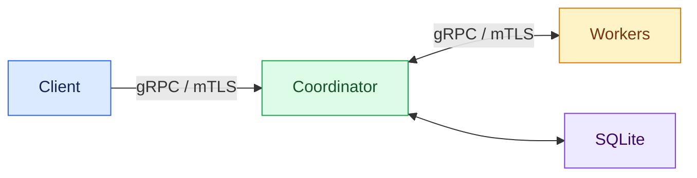

[简体中文](README.md) | English

# DistributedZKRuntime

## Project Introduction

DistributedZKRuntime is a Go distributed job runtime with one Coordinator, multiple Workers, gRPC/mTLS communication, and SQLite-backed job state and full task specifications. The runtime manages execution attempts, retries, leases, stale-result fencing, cancellation, and restart recovery. A Groth16 proof of a MiMC preimage relation on BN254 is a specialized workload: Workers generate proofs, and the Coordinator independently verifies the results.

The project focuses on result acceptance when remote computation outlives a request, a Worker fails, or the Coordinator restarts. The six design decisions below explain how proof verification, attempt identity, and resource lifetimes distinguish an eligible result from an obsolete attempt.

## Architecture Overview



The Client submits jobs synchronously to the Coordinator, which selects live Workers using round robin and manages execution attempts and job state. Workers execute tasks and return results. For successful ZK results, the Coordinator independently verifies the proof and durably saves terminal state to SQLite before returning a response to the Client. The persisted job state also supports recovery after restart.

## Core Capabilities

- **Distributed execution:** Registration, heartbeat, liveness detection, and hash, sleep, and preimage proof tasks.
- **Reliability:** AttemptIDs, leases, result fencing, failure retries, cancellation, SQLite recovery, and bounded shutdown.
- **Trust and capacity:** mTLS authorization, public payload validation, independent Groth16 verification, and Worker proving admission.
- **Observability and experiments:** Semantic metrics, a Prometheus backend, and standalone CPU MiMC Chain experiments.

## Design Decisions

### 1. How can the Coordinator verify a result without knowing the Worker's secret?

Putting the secret in the submission payload would expose a value intended to remain on the Worker. The production task, `zk_preimage_prove`, therefore submits only a public digest and a `witness_ref`. The Worker resolves the secret through its local WitnessStore, and [ZKPreimageTask](internal/runtime/zk_preimage_task.go) generates a Groth16 proof of `MiMC(secret) == digest`. With the pinned dependencies, this BN254/R1CS circuit has 331 constraints.

A Worker reporting Succeeded is not enough to establish that relation. The [Coordinator](cmd/coordinator/zk_preimage_verifier.go) actually invokes Verify with the matching verifying key and public digest, without obtaining the secret or repeating the private computation. Holding private inputs and checking the result are separate responsibilities: the Worker produces the proof, and the Coordinator uses it to assess the public statement.

### 2. Why does mTLS still need WorkerID binding and RPC authorization?

mTLS establishes a connection's peer identity, but does not by itself decide which operations that peer may perform. The project requires TLS 1.3/mTLS and uses [method authorization](internal/rpcauth/policy.go) to distinguish roles: Clients submit jobs, Workers register and heartbeat, and only the configured Coordinator can invoke a Worker's ExecuteJob. Connection identity and application permissions are checked separately.

WorkerID is still a field supplied by the caller, so registration and heartbeat bind it to the certificate's Worker identity. Registration also [checks that the advertised address matches the certificate hostname](cmd/coordinator/transport.go); outbound connections verify DNS/IP SANs and the expected URI identity. These checks connect the logical Worker selected for scheduling to the actual peer and endpoint, rather than trusting a request field alone.

### 3. Why can a mathematically valid Worker result still be rejected?

Suppose Attempt 1's lease expires and the Coordinator cancels it and starts Attempt 2, while the old Worker is still finishing a synchronous proof. Even a correct proof from that Worker must not overwrite the new attempt's result. JobID identifies the job, a monotonic AttemptID distinguishes generations, and a lease defines each attempt's eligibility window. Proof validity and attempt validity are independent conditions.

The [execution path](cmd/coordinator/execution.go) checks response JobID, AttemptID, and the current lease before verifying a proof. Cancellation or lease expiry can also occur during Verify, so persistTerminalResult checks the parent context and lease again before saving terminal state. That check and Save hold the same mutex to exclude local generation replacement between them. Old computation may overlap a retry, but a late valid proof does not automatically become an acceptable result.

### 4. How does the Coordinator preserve attempt identity across crashes and recovery?

An in-memory AttemptID could reset to 1 after restart and reuse an old generation. SQLite JobRecords therefore retain the generation and full task specification. [Attempt allocation](cmd/coordinator/attempts.go) uses `nextAttempt = max(inMemoryAttempt, persistedAttempt) + 1`, saves JobRunning first, publishes the in-memory AttemptID and lease, and then dispatches. A failed Save publishes no attempt; a persisted Attempt 7 advances to Attempt 8 in a fresh process.

Startup recovery marks Running records with valid task specifications as Recovering, retaining their generation and inputs until execution actually resumes. The [recovery entry point](cmd/coordinator/jobs.go) claims JobID ownership, reloads the record, converts it to JobSpec, and reuses the ordinary submission path's executeJobFromSource. Recovery consequently follows the same retry, proof verification, and terminal acceptance rules rather than maintaining a second execution implementation that can drift.

### 5. Why doesn't cancelling a Groth16 task immediately release its concurrency slot?

Go context cancellation is cooperative; the current synchronous Groth16 Prove call does not stop automatically. A request can end or the Coordinator can retry while the old proof still consumes CPU. Releasing its slot immediately would admit new computation before the previous work finished, allowing repeated cancellation to push actual concurrency beyond the configured capacity.

The Worker's shared [ProvingLimiter](internal/runtime/proving_limiter.go) therefore retains the slot until the task actually exits and returns ResourceExhausted when full. [ZKPreimageTask](internal/runtime/zk_preimage_task.go) checks cancellation before Prove and the result deadline after proof generation and encoding. Late output can be discarded while unfinished computation still counts against capacity. Worker shutdown also joins actual handlers, tying resource release to computation completion.

### 6. Why isn't exit code zero enough to establish a successful CPU Groth16 experiment?

A normal exit only says the program reported success, not that it performed the intended cryptographic operations or measured the right window. The [CPU pilot](internal/zk/experimental/mimcchain/pilot_n2_test.go) records actual operation starts, ends, counts, and outcomes. In the accepted N=8 workflow, source, binary, and policy are bound to the same run. A Barrier confirms readiness before releasing work so observation and execution order can be checked.

Resource evidence retains raw process-group RSS samples and checks ownership and cleanup of managed processes. The [final collector](tools/bench/d2_collect.py) combines operation records, provenance bindings, resource observations, and deadlines when deciding acceptance; missing or contradictory evidence cannot pass merely because the exit code is zero. Independent checking reconciles Verify records from the source-bound Go program rather than rerunning mathematical verification. The accepted N=8 pilot demonstrates this evidence chain from actual calls to final acceptance.

## CPU Experiments

The standalone [MiMC Chain](internal/zk/experimental/mimcchain/circuit.go) uses a fixed-length hash chain, separate from the production preimage task and not integrated into job scheduling. N=2 and N=8 have both completed real CPU Groth16 pilots, with the N=8 pilot independently accepted.

| Metric | N=2 | N=8 |
|---|---:|---:|
| Constraints | 661 | 2,641 |
| Setup | 54.18 ms | 204.938 ms |
| Prove | 9.52 ms | 29.743 ms |
| Verify | 0.50 ms | 0.615 ms |

Each timing is a single observed invocation, not a statistical average or a claim about production throughput or statistical scaling. The N=8 common-sample process-group RSS peak was **21,484 KiB**; finite sampling does not establish the lifetime peak or a hard memory limit. Measurement definitions are in the [benchmark contracts](docs/benchmark-contracts.md).

## Quick Start

Run the real local demo from the repository root on **Linux/WSL**:

```sh
go run -mod=readonly ./cmd/demo
```

You need a local toolchain meeting the Go **1.27.1** requirement in [go.mod](go.mod), Bash, OpenSSL 3, Git, the required GNU utilities, and cached Go dependencies. The demo's child commands build offline; they do not install tools or download missing dependencies.

The demo starts real Coordinator/Worker processes, generates isolated temporary development PKI, executes a deterministic hash task over gRPC/mTLS, and independently checks the SHA-256 output and SQLite terminal state. Both services use `-disable-zk=true`, so no Groth16 keys or private witness are required. On success, it reaps owned child processes and removes temporary files. See the [local demo guide (Chinese)](docs/demo.md) for operation, failure diagnostics, and the recovery-test walkthrough.

For a build check alone, use:

```sh
go build -mod=readonly ./...
```

A build check neither starts the demo nor provisions runtime materials. Starting services manually in the default ZK mode still requires a trusted CA and role- and endpoint-matching mTLS certificates, identity allowlists, matching Groth16 proving/verifying keys, Worker-local witness data, and a writable SQLite path. See the [test execution contract](docs/testing.md) for test entry points and environment requirements.

## Scope and Limitations

The runtime uses one Coordinator and multiple Workers, with SQLite-backed job state and restart recovery; multi-Coordinator high availability is not supported. AttemptIDs and leases govern result acceptance. Old computation can overlap a retry, so result fencing does not guarantee exactly-once execution: performing a computation and accepting its result are separate events.

The production ZK workload is a Groth16 proof of a MiMC preimage relation on BN254. MiMC Chain is a separate experiment: N=2 and N=8 have completed CPU pilots, while N=32 has compile-only calibration. These experimental timings describe individual observed operations, not production-system throughput.
